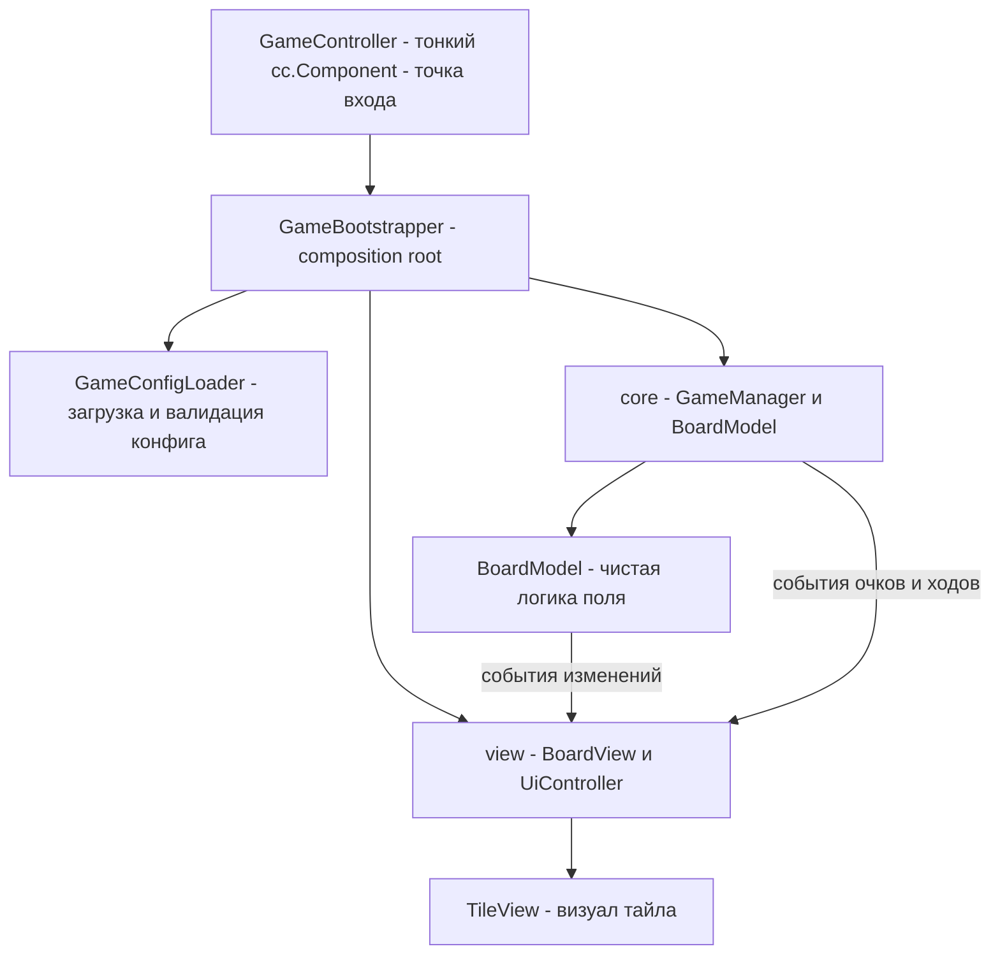
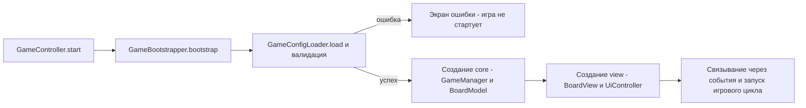

# План реализации игры «Blast» (Cocos Creator 2.4.x)

> План составлен по описанию в `doc/description.md`.
> Требование: руководствоваться принципами ООП и SOLID.

## 1. Контекст проекта

- **Движок:** Cocos Creator 2.4.15 (`project.json`), 2D-игра на TypeScript.
- **Текущее состояние:** пустой шаблон hello-world — есть только `assets/Script/Helloworld.ts`, сцена `assets/Scene/helloworld.fire` и текстура `assets/Texture/singleColor.png`, из которой создаются цветные тайлы (окрашиванием спрайта).
- **Механика (из ТЗ):**
  1. Генерируется поле N×M.
  2. В каждой ячейке — тайл определённого цвета.
  3. Клик по тайлу сжигает всю прилегающую группу тайлов того же цвета.
  4. Оставшиеся тайлы опускаются вниз.
  5. Пустые ячейки сверху заполняются новыми тайлами.
  6. Цель — набрать X очков за Y ходов; если ходов не хватило или хода нет — проигрыш.

## 2. Архитектура

Разделение на слои: **чистая логика игры** (без зависимостей от движка — тестируемая) и **визуальный слой** (Cocos-компоненты). Связь — событиями. Это ключевые принципы SRP и Dependency Inversion.



### Состояния игры

`LoadingConfig → Idle → Animating → Win / Lose`. Ввод блокируется во время анимаций (`Animating`).

## 3. Структура файлов

```
assets/
├── resources/
│   └── config/
│       └── game-config.json      ← все игровые правила
└── Script/
    ├── config/
    │   ├── GameConfig.ts         ← типизированный интерфейс конфига
    │   └── GameConfigLoader.ts   ← загрузка cc.JsonAsset, парсинг, валидация
    ├── core/                     ← чистая логика игры, без cc.* (кроме типов)
    │   ├── GameBootstrapper.ts   ← composition root: создаёт и связывает core и view
    │   ├── GameManager.ts        ← правила, очки, ходы, конец игры
    │   ├── BoardModel.ts         ← сетка тайлов, flood fill, гравитация, заполнение
    │   └── TileModel.ts          ← данные тайла: цвет, координаты
    ├── view/
    │   ├── BoardView.ts          ← создание тайлов, анимации сгорания/падения
    │   ├── TileView.ts           ← спрайт тайла, обработка клика
    │   └── UiController.ts       ← очки/ходы, экраны победы/поражения
    └── GameController.ts         ← тонкий cc.Component: делегирует старт GameBootstrapper
```

### GameBootstrapper (composition root)

`GameBootstrapper` — единственное место, где создаются и связываются основные компоненты игры:

1. Загружает и валидирует конфиг через `GameConfigLoader`.
2. Создаёт **core**: `BoardModel`, `GameManager` (получают `GameConfig` через конструктор — DIP).
3. Создаёт **view**: `BoardView`, `TileView` (префаб тайла), `UiController`.
4. Связывает слои через события: модель → view (сгорание/падение/заполнение), `GameManager` → `UiController` (очки/ходы/итог).
5. Подписывает `BoardView` на ввод пользователя и передаёт клики в `GameManager`.
6. Управляет состояниями игры (`Idle`, `Animating`, `Win`, `Lose`).

`GameController` остаётся тонким `cc.Component` на сцене: в `start()` вызывает `new GameBootstrapper(...).bootstrap()` и хранит ссылки, переданные редактором (контейнеры, префаб тайла, ссылки на UI-элементы).

## 4. Конфигурация правил (загружается при старте сессии)

Файл `assets/resources/config/game-config.json`:

```json
{
    "board": { "width": 9, "height": 9, "colorsCount": 5 },
    "goal": { "targetScore": 3000, "movesLimit": 20 },
    "scoring": { "basePerTile": 10, "chainBonusMultiplier": 1 },
    "visual": { "tileSize": 64, "animBurnDuration": 0.15, "animFallDuration": 0.25 }
}
```

- **Правила** (`board`, `goal`, `scoring`) — параметры, требуемые ТЗ (N, M, цвета, X очков, Y ходов).
- **Визуальные параметры** (`visual`) — поле подстраивается под размеры из правил.
- Формула очков: `score = basePerTile × n + chainBonusMultiplier × n × (n − 1)`, где n — размер сгоревшей группы. Множители конфигурируемы, формула в коде `GameManager` (Open/Closed).
- Загрузка: `GameController.start()` → `GameBootstrapper.bootstrap()` → `GameConfigLoader.load()` через `cc.resources.load(..., cc.JsonAsset)` → парсинг и валидация → сборка core и view.

### Валидация конфига

`GameConfigLoader` проверяет: положительные размеры поля, `colorsCount ≥ 2`, положительные `targetScore` и `movesLimit`. При ошибке — понятное сообщение с указанием некорректного поля; игра не стартует. Чистая логика получает уже провалидированный типизированный `GameConfig` (правила приходят извне, не захардкожены — DIP).

### Схема старта сессии



## 5. Алгоритмы

- **Поиск группы (flood fill):** BFS от кликнутого тайла по соседям из 4 направлений с тем же цветом. Группа < 2 тайлов → клик игнорируется.
- **Гравитация:** для каждого столбца тайлы сдвигаются вниз, заполняя пустоты; сверху добавляются новые тайлы случайных цветов.
- **Проверка проигрыша «нет хода»:** на поле не осталось ни одной группы из 2+ тайлов того же цвета.

## 6. Принципы SOLID

- **S:** `BoardModel` — только логика поля; `GameManager` — только правила/очки/ходы; `BoardView` — только визуал; `GameBootstrapper` — только сборка и связывание компонентов; `GameController` — только точка входа на сцене.
- **O:** новые правила начисления очков/пороги — через конфиг, без правки логики.
- **L/ISP/D:** модель не знает про Cocos и визуал; связь через события; конфиг передаётся зависимостью.

## 7. Игровой цикл

1. Клик по тайлу → flood fill группы того же цвета.
2. Группа < 2 → игнор.
3. Анимация сгорания → удаление тайлов из модели.
4. Гравитация: опускание тайлов, заполнение сверху новыми.
5. Списание хода, начисление очков.
6. Проверка: цель достигнута → победа; ходы кончились или нет доступных групп → проигрыш.

## 8. Чек-лист задач

- [ ] Создать JSON-конфиг правил в `assets/resources` и парсер `GameConfigLoader` с валидацией
- [ ] Создать `GameBootstrapper` — composition root: создание и связывание core и view
- [ ] Создать модель данных: `BoardModel` / `TileModel`, типы данных
- [ ] Реализовать алгоритм поиска группы тайлов одного цвета (flood fill)
- [ ] Реализовать логику гравитации: опускание тайлов и заполнение сверху
- [ ] Реализовать `GameManager`: ходы, очки, условия победы/поражения на основе конфига
- [ ] Реализовать визуальный слой: генерация тайлов, анимации сгорания/падения
- [ ] Реализовать UI: отображение ходов и очков, экраны победы/поражения
- [ ] Настроить сцену `helloworld.fire` (поле, UI, префаб тайла)
- [ ] Тестирование игрового цикла: клик → сгорание → падение → заполнение → проверка конца игры
- [ ] Проверить обработку проигрыша при отсутствии доступных ходов
