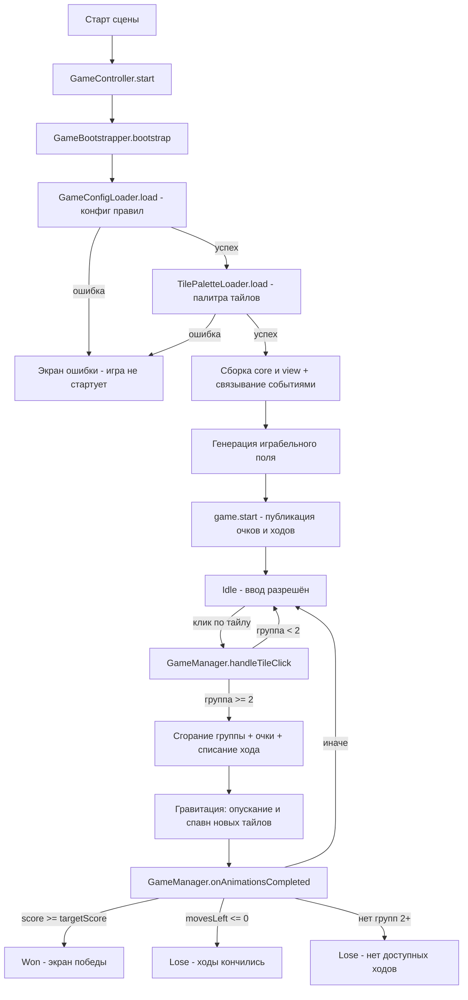
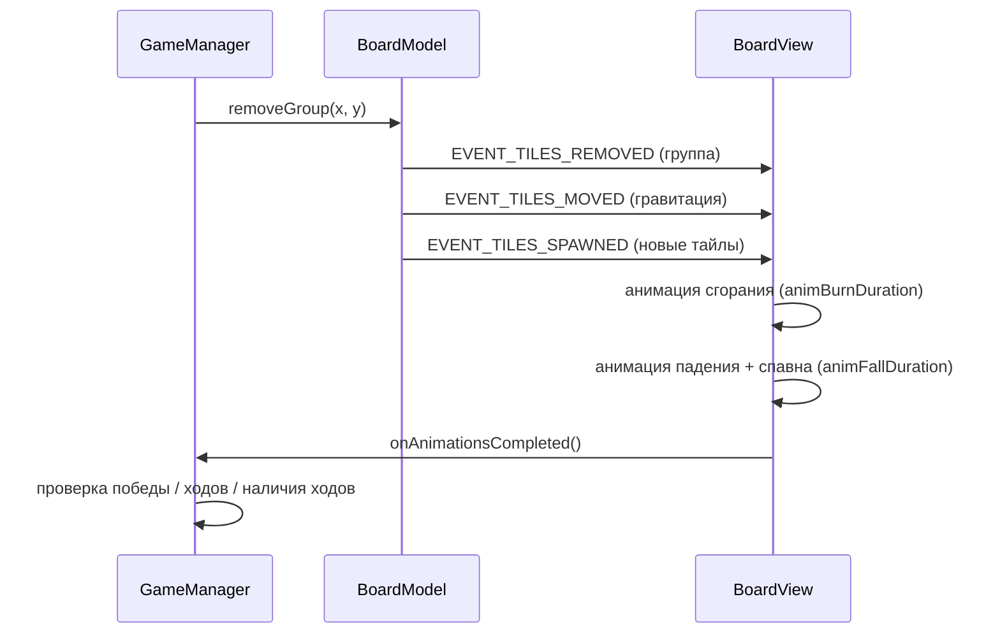
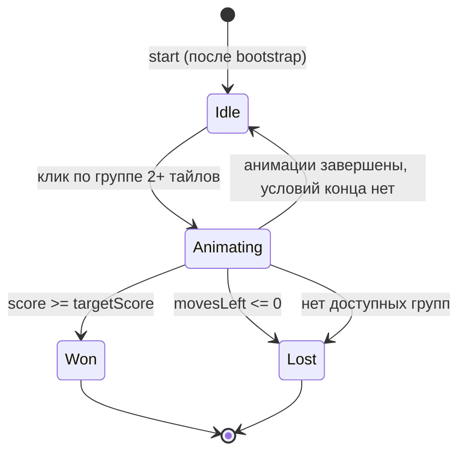

# Флоу игры «Blast»

> Описание фактического игрового флоу по текущей реализации.
> Общая механика описана в [`doc/description.md`](../description.md),
> план реализации — в [`blast-game-plan.md`](blast-game-plan.md).

## 1. Общая схема флоу



## 2. Запуск сессии (bootstrap)

Точка входа — [`GameController.ts`](../../assets/Script/GameController.ts), тонкий `cc.Component` на сцене: в `start()` он создаёт [`GameBootstrapper`](../../assets/Script/core/GameBootstrapper.ts) и вызывает [`bootstrap()`](../../assets/Script/core/GameBootstrapper.ts:32).

Последовательность:

1. **Загрузка конфига правил** — [`GameConfigLoader`](../../assets/Script/config/GameConfigLoader.ts) читает `assets/resources/config/game-config.json` (через `cc.resources.load`), парсит и валидирует. При ошибке — [`UiController.showError`](../../assets/Script/view/UiController.ts:50), игра не стартует.
2. **Загрузка палитры тайлов** — [`TilePaletteLoader`](../../assets/Script/config/TilePalette.ts) загружает `tile-palette.json` и текстуры тайлов по числу цветов из конфига.
3. **Сборка core** — [`GameBootstrapper.startGame`](../../assets/Script/core/GameBootstrapper.ts:52) создаёт:
   - [`BoardModel`](../../assets/Script/core/BoardModel.ts) — сетка `width × height`, `colorsCount` цветов;
   - [`GameManager`](../../assets/Script/core/GameManager.ts) — правила, очки, ходы (конфиг передаётся через конструктор — DIP).
4. **Сборка view** — [`BoardView.init`](../../assets/Script/view/BoardView.ts:66) привязывает модель и рантайм-зависимости (палитра, визуальные параметры, колбэк завершения анимаций); [`UiController.bindGame`](../../assets/Script/view/UiController.ts:27) подписывает счётчики и экран результата на события `GameManager`.
5. **Связывание ввода** — [`BoardModel.EVENT_TILE_CLICKED`](../../assets/Script/core/BoardModel.ts:41) → `GameManager.handleTileClick`.
6. **Генерация поля** — [`generatePlayableBoard`](../../assets/Script/core/GameBootstrapper.ts:82): `BoardModel.generate()` повторяется до 100 раз, пока на поле не появится хотя бы одна группа из 2+ тайлов (`hasAvailableMoves`).
7. **Старт сессии** — [`GameManager.start`](../../assets/Script/core/GameManager.ts:58) публикует начальные значения очков и ходов. Состояние — `Idle`, ввод разрешён.

## 3. Игровой ход (клик по тайлу)

Цепочка клика:

```
TileView (touch) → TileModel.click() → TileModel.EVENT_CLICKED
    → BoardModel.EVENT_TILE_CLICKED → GameManager.handleTileClick(x, y)
```

Обработка в [`GameManager.handleTileClick`](../../assets/Script/core/GameManager.ts:68):

1. **Проверка состояния** — ход принимается только в `Idle`; в `Animating`, `Won`, `Lost` ввод игнорируется.
2. **Сжигание группы** — [`BoardModel.removeGroup`](../../assets/Script/core/BoardModel.ts:139):
   - [`findGroup`](../../assets/Script/core/BoardModel.ts:95): BFS (DFS-стек) от кликнутого тайла по 4 направлениям, тайлы того же `colorIndex`. Группа < 2 тайлов → `null`, клик игнорируется;
   - тайлы удаляются из сетки → событие `EVENT_TILES_REMOVED` (view запускает анимацию сгорания);
   - [`applyGravity`](../../assets/Script/core/BoardModel.ts:183): в каждом столбце тайлы уплотняются вниз → `EVENT_TILES_MOVED`; пустые верхние ячейки заполняются новыми случайными тайлами → `EVENT_TILES_SPAWNED` (spawn-строка выше верхней границы поля для анимации входа).
3. **Переход в `Animating`** — ввод блокируется до конца анимаций.
4. **Начисление очков** — формула [`calculateScore`](../../assets/Script/core/GameManager.ts:124):
   `score = basePerTile × n + chainBonusMultiplier × n × (n − 1)`, где `n` — размер группы. Событие `EVENT_SCORE_CHANGED` → [`ScoreCounter`](../../assets/Script/view/ScoreCounter.ts).
5. **Списание хода** — `movesLeft -= 1`, событие `EVENT_MOVES_CHANGED` → [`MovesCounter`](../../assets/Script/view/MovesCounter.ts).

## 4. Завершение хода (проверка условий)

Когда [`BoardView`](../../assets/Script/view/BoardView.ts) заканчивает анимации (сгорание `burnDuration` → падение `fallDuration`), он вызывает колбэк → [`GameManager.onAnimationsCompleted`](../../assets/Script/core/GameManager.ts:94). Проверки в порядке приоритета:

| Условие | Результат |
|---|---|
| `score >= targetScore` | **Победа** — событие `EVENT_GAME_WON` → [`ResultScreen.show('You Win!')`](../../assets/Script/view/UiController.ts:37) |
| `movesLeft <= 0` | **Проигрыш** (`outOfMoves`) — `EVENT_GAME_LOST` → `ResultScreen.show('You Lose!')` |
| [`!hasAvailableMoves`](../../assets/Script/core/BoardModel.ts:155) — нет ни одной пары соседних тайлов одного цвета | **Проигрыш** (`noMoves`) |
| иначе | Возврат в `Idle`, ходы продолжаются |

Тайминг анимаций хода:



## 5. Состояния игры

Конечный автомат [`GameState`](../../assets/Script/core/GameManager.ts:6):



- **Idle** — ввод разрешён.
- **Animating** — ввод заблокирован, идёт сгорание/падение.
- **Won / Lost** — терминальные состояния, показывается [`ResultScreen`](../../assets/Script/view/ResultScreen.ts).

## 6. Распределение ответственности по слоям

| Слой | Компонент | Роль во флоу |
|---|---|---|
| Точка входа | [`GameController`](../../assets/Script/GameController.ts) | Запускает `GameBootstrapper` в `start()` |
| Сборка | [`GameBootstrapper`](../../assets/Script/core/GameBootstrapper.ts) | Загрузка конфига/палитры, создание core и view, связывание событиями |
| Конфигурация | [`GameConfigLoader`](../../assets/Script/config/GameConfigLoader.ts), [`TilePaletteLoader`](../../assets/Script/config/TilePalette.ts) | Правила и визуал приходят извне, с валидацией |
| Core (логика) | [`BoardModel`](../../assets/Script/core/BoardModel.ts), [`TileModel`](../../assets/Script/core/TileModel.ts) | Сетка, flood fill, гравитация, генерация тайлов; события кликов и изменений поля |
| Core (правила) | [`GameManager`](../../assets/Script/core/GameManager.ts) | Состояния, очки, ходы, условия победы/поражения |
| View | [`BoardView`](../../assets/Script/view/BoardView.ts), [`TileView`](../../assets/Script/view/TileView.ts) | Спавн тайлов из префаба, анимации сгорания/падения, обработка тача |
| UI | [`UiController`](../../assets/Script/view/UiController.ts), счётчики, [`ResultScreen`](../../assets/Script/view/ResultScreen.ts) | Отображение очков/ходов, экраны результата и ошибок |

Связь между слоями — только события ([`EventEmitter`](../../assets/Script/core/EventEmitter.ts)) и DI через конструкторы/`init()`; view не содержит игровой логики.
